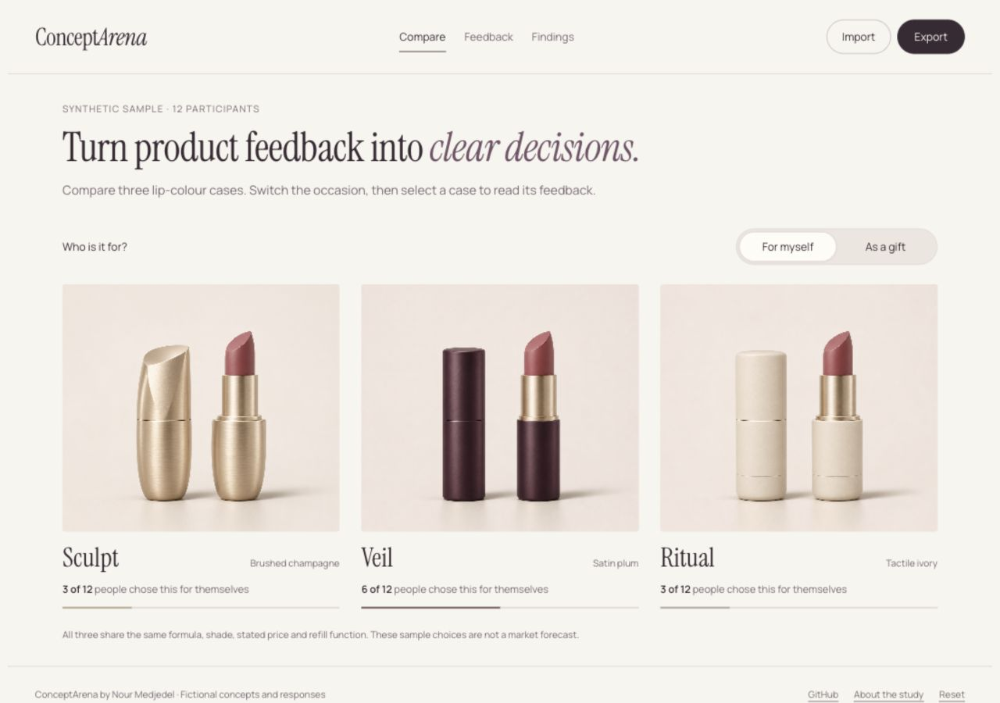

# ConceptArena

A beauty research studio that connects packaging feedback to a decision you can defend.

Compare three fictional lip-colour concepts, follow a participant's reasoning, review the coding, then export an editable presentation with supporting and contrasting evidence.

**[Try the live demo](https://nourmedjedel.github.io/concept-arena/)** · [Research rationale](docs/research-brief.md)



## Try it in one minute

1. **Compare:** switch between **For myself** and **As a gift**. The explicit choices change from Veil (6 of 12) to Sculpt (7 of 12). Select a case to continue.
2. **Feedback:** read source-linked responses. Filters, individual participants and theme review are available when needed. **Check themes** opens the optional local-AI assistant.
3. **Findings:** open a finding, inspect support and counterexamples, edit the recommendation and approve it. **Export** creates editable PPTX slides and an XLSX evidence workbook.

A relevant coding change marks its dependent finding for review. Draft and outdated interpretations cannot enter the presentation.

All 12 participants, 96 responses and 24 choices are **synthetic and authored for this demonstration**. The product illustrations are original AI-generated concepts, not real products or tested physical prototypes. No client data, brand affiliation or consumer fieldwork is represented.

## Run locally

Requires Node.js 22.12+ and npm. No account or paid API is needed.

```sh
npm ci
npm run dev
```

Open <http://127.0.0.1:8789/>. Workbook processing and exports work without a model.

Optional local AI assistance:

```sh
ollama pull qwen3:8b
ollama serve
```

If Ollama is already running, leave that instance running. Open **Check themes**, then **Suggest with local AI**. The development server sends only the selected response to `127.0.0.1:11434`; the model returns themes, stance and an exact excerpt. Review the proposal before saving. Temperature is 0, context 4,096 tokens and maximum output 280 tokens; see [the adapter](scripts/local-assist.mjs). A schema-valid answer can still be semantically wrong.

The public static demo has **three recorded Qwen3:8b outputs**, for R006, R014 and R026. They are labelled with model and date, matched to the exact source text and never presented as a fresh inference. Try Sculpt's refill comments (R026) or Ritual's first full-concept response (R006). Other responses require local mode. All initial study coding is researcher-authored.

To regenerate recorded proposals against the installed local model:

```sh
npm run cache-ai
```

## Your own workbook

Use **Import → Download sample workbook** as the template. This first version supports the same three-concept study structure, not arbitrary research files or automatic column mapping.

- `Responses`: `id`, `participant`, `concept` (A/B/C), `question`, `context` (general/personal/gift), `phase` (pack/concept), `language`, `text`, `codes`, `region`, `stance`, `status`.
- `Choices`: `participant`, `context` (personal/gift), `concept`, `responseId`. One explicit choice per person and occasion, linked to a matching response.
- `Participants` (optional): `id`, `language`, `routine`.

Theme codes and region names are provided in the sample's `Codebook` sheet. Use semicolons between themes. Stance is `positive`, `concern`, `neutral` or `mixed`; coding status is `authored`, `reviewed` or `needs_review`. Missing status defaults to review. Use plain values rather than formulas.

Maximum compressed workbook size: 4 MB; maximum 5,000 data rows per input sheet. Imported text is rendered as text. Files are parsed in the browser and replace the in-memory session only after validation. Reloading the page resets the session, so export your evidence workbook to keep changes. Do not use this prototype for confidential research without your own deployment review.

## What the analysis means

- Theme counts deduplicate participant IDs. Repeated mentions do not increase the count.
- Choice counts use explicit choice records. Sentiment never becomes an inferred preference.
- Pack-only and full-concept evidence remain distinct; general reactions are shown alongside the selected occasion's answers.
- The three finding structures are deliberately authored for this study. The app recomputes their evidence and quantities; it does **not** claim to discover arbitrary insights automatically.
- Findings separate observation, interpretation, support and counterevidence. A change to relevant coding or a recommendation invalidates that approval.
- Packaging detail tags are semantic annotations, **not eye tracking**.
- The proposed refill explanation is **untested**. There is no simulated preference lift, representative market estimate, significance test or sales forecast.

A useful review example: Qwen3 labels R006's refill comment as *neutral*, while the authored coding is *positive*. The demo exposes that disagreement instead of quietly treating the model as ground truth. This is an illustration, not a benchmark.

## Engineering

Vanilla JavaScript, Vite, ExcelJS and PptxGenJS; a small Ollama adapter runs only in local development. No hosted model, database, tracking script or application upload endpoint. PPTX/XLSX libraries load on demand, keeping the initial study view lighter. Normal hosting access logs may still exist.

```sh
npm test                 # counting, review invalidation, validation, XLSX roundtrip and PPTX generation
npm run format:check
npm run build            # static dist/ for GitHub Pages
npm run samples          # editable sample artifacts/ files
```

The sample deck has been rendered with LibreOffice and checked visually. It contains a native chart with its embedded spreadsheet, editable text, original raster illustrations and source IDs in slide notes. Cross-application rendering can differ.

`web/model.js` contains the analysis rules; `web/exports.js` contains workbook parsing and export builders. Patched transitive dependency versions are pinned with npm overrides; the lockfile is committed. CI checks formatting, tests and build before deployment.

## Next, deliberately small

- Independently labelled French/English coding examples and error analysis.
- Column mapping and additional study formats, with explicit missing-data handling.
- Quote-span annotations and versioned stimuli connected to the next fieldwork round.

[Product brief](docs/product-brief.md) · [Public research sources](docs/research-brief.md) · [Image provenance](web/public/assets/PROVENANCE.md)

MIT for repository code. Generated illustrations are provided as fictional demo assets; their provenance and limitations are documented separately.

Typography: Instrument Serif and Manrope, bundled locally under the SIL Open Font License. License texts are included in `web/public/assets/fonts/`.
